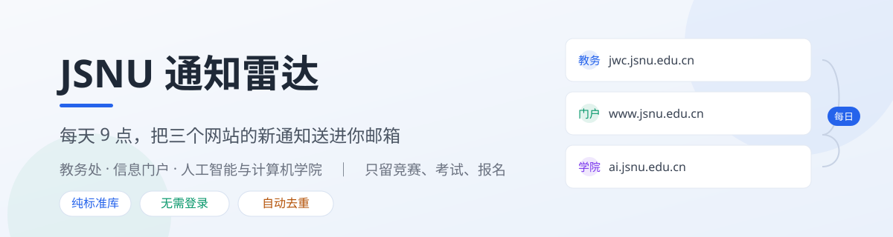
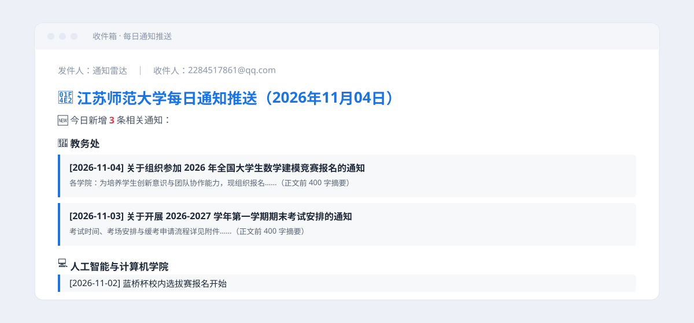
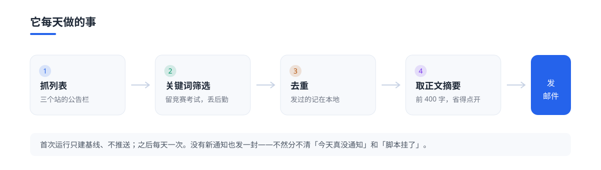

<p>
  
  
  
  
</p>

**每天 9 点，学校三个网站的新通知自动整理好，发到你 QQ 邮箱。** 只留竞赛、考试、报名那类，后勤招标一概不看。

教务处、信息门户、学院网站各发各的，一天不看就积一堆，漏一条可能就是错过报名。这事不难，难在要天天记得——所以交给它。

---

## 效果



一封邮件里三件事：今天新增几条、每条来自哪个站、点开之前就能看正文前 400 字。

---

## 它每天做的事



| 环节 | 说明 |
|---|---|
| 抓列表 | 三个栏目页，解析标题、日期、链接 |
| 关键词筛选 | 命中「竞赛 / 考试 / 报名」等保留，命中「后勤 / 招标 / 教职工」等丢弃 |
| 去重 | 按「标题 + 日期」算哈希，发过的记在 `sent_state.json`，下次只发新的 |
| 取摘要 | 进正文页，抓前 400 字（正文容器名可配，见下文） |
| 投递 | QQ 邮箱 SMTP，HTML 邮件，手机推送一响就知道 |

---

## 功能

| 功能 | 说明 |
|---|---|
| ✅ 零第三方依赖 | 只用 Python 标准库，`pip install` 都不用 |
| ✅ 不用登录 | 抓的是公开栏目页，不需要账号、不碰任何个人信息 |
| ✅ 首次只建基线 | 刚跑起来不会一口气推几十条历史通知 |
| ✅ 无新通知也发信 | 每天一封，不然分不清「今天真没通知」和「脚本挂了」 |
| ✅ 关键词可改 | 保留词、排除词都是文件顶部的两个列表，改成自己学院的词就行 |
| ✅ 状态可回滚 | 删掉 `sent_state.json` 就回到「全部当新」的状态 |

---

## 快速开始

**1. 拿代码**

```bash
git clone https://github.com/xm2284/jsnu-notice-radar.git
cd jsnu-notice-radar
```

国内打不开 GitHub 就用 Gitee 镜像：`git clone https://gitee.com/xm2284/jsnu-notice-radar.git`

**2. 开 QQ 邮箱的 SMTP，拿到授权码**

QQ 邮箱 → 设置 → 账号 → 开启「POP3/SMTP 服务」→ 按提示验证 → 得到一串 16 位授权码。
（授权码不是 QQ 密码，别填错。）

**3. 填配置**

```bash
cp config.example.json config.json
```

```json
{
  "smtp_server": "smtp.qq.com",
  "smtp_port": 465,
  "sender": "你的QQ号@qq.com",
  "auth_code": "这里填授权码",
  "receiver": "收信邮箱，填自己也行"
}
```

**4. 先手跑一次**

```bash
python daily_notice_radar.py
```

第一次会建基线并给你发一封「已启动」，这是正常的。之后有新增才会推正文。

**5. 挂到定时任务**

Windows（计划任务，每天 9:00）：

```powershell
schtasks /create /tn "通知雷达" /tr "pythonw.exe D:\radar\daily_notice_radar.py" /sc daily /st 09:00
```

Linux / macOS：

```bash
crontab -e
# 每天早上 9 点
0 9 * * * /usr/bin/python3 /home/you/jsnu-notice-radar/daily_notice_radar.py >> /tmp/radar.log 2>&1
```

---

## 想换成自己的学校

改脚本顶部三个地方就够了：

```python
SOURCES = {
    "jwc":    "http://jwc.jsnu.edu.cn/tzgg/",          # 改成你们学校教务处的通知栏目
    "portal": "http://www.jsnu.edu.cn/xxmhwtzgg/list1.htm",
    "ai":     "http://ai.jsnu.edu.cn/main.htm",
}

INCLUDE_KW = ["竞赛", "比赛", ...]   # 想收什么
EXCLUDE_KW = ["招标", "后勤", ...]   # 不想看到什么
```

如果新站点的列表结构解析不出来（`[jwc] 共 0 条相关`），把那一页的 HTML 存一份丢给 AI，说明「这是列表页，要标题、日期、链接」，让它补一个解析函数挂到 `extract_list_items` 里即可。

正文摘要取不到时，多半是正文容器名不对。在 `fetch_summary` 的 class 列表里加上正确的那一个就行。

---

## 常见问题

**Q：第一次运行没收到正文邮件？**
只发了「已启动」那一封。基线建立后，第二天开始才有正文。

**Q：某天没收到邮件？**
先看脚本有没有跑起来（Windows 计划任务里看上次运行结果）。真跑挂了它也发不出信，所以建议把「无新通知也发信」一直开着，收到空邮件就说明它还活着。

**Q：会漏通知吗？**
不会漏「新发出来的」，但如果一条通知在你第一次建基线之前就存在，它会被记为已看，不会再推。想重来就删掉 `sent_state.json`。

**Q：能不能不经过邮箱，直接推微信 / 企业微信？**
可以，把 `send_email` 换成对应的 webhook 推送即可，其余逻辑不动。

---

## 使用边界

- 抓的都是学校公开发布的通知页面，不涉及任何账号与个人信息；
- 每天只跑一次，不对服务器造成压力；
- 不绕过任何付费墙、登录墙；
- 仅供个人学习与自用，请遵守学校网络使用规定。

---

## License

[MIT](LICENSE) © 2026 何明（xm2284）

如果这个工具帮你少刷了几次网站，点个 Star 就行。
